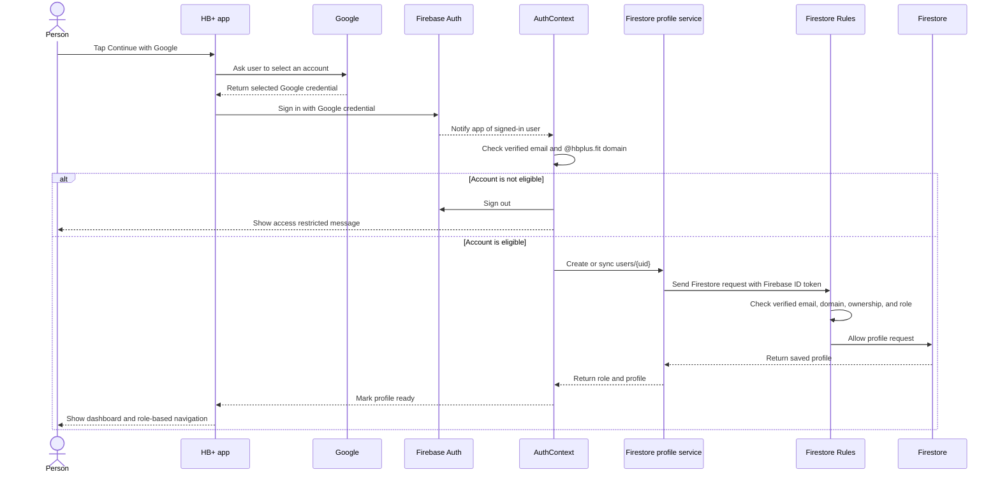
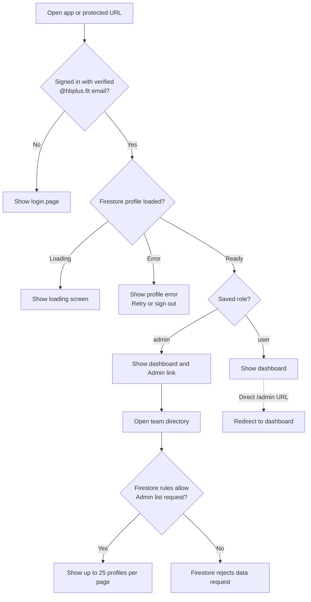

<div align="center">
  <h1>HB+ Auth</h1>
  <p><strong>One Google sign-in experience for web, Android, and iOS.</strong></p>
  <p><a href="https://hbplus-auth.vercel.app/"><strong>Open the live web app ↗</strong></a></p>
  <p>
    
    
    
    
  </p>
</div>

HB+ Auth is a cross-platform assessment project built with Expo, React Native, and React Native Web. Team members sign in with Google. The app allows verified **@hbplus.fit** accounts into its dashboard and gives users an Admin or User role. Firestore Security Rules protect stored profile data independently of the app screens.

## Contents

- [At a glance](#at-a-glance)
- [Architecture](#architecture)
- [Sign-in and authorization flows](#sign-in-and-authorization-flows)
- [Profiles, roles, and permissions](#profiles-roles-and-permissions)
- [Security boundaries](#security-boundaries)
- [Technology stack](#technology-stack)
- [Project structure](#project-structure)
- [Set up Firebase and Google sign-in](#set-up-firebase-and-google-sign-in)
- [Run the app](#run-the-app)
- [Run the tests](#run-the-tests)
- [Build and deploy](#build-and-deploy)
- [Troubleshooting](#troubleshooting)

## At a glance

| Item | Value |
| --- | --- |
| Firebase project | `hbplus-auth-212` |
| Allowed account | Verified email ending in `@hbplus.fit` |
| Web hosting | [hbplus-auth.vercel.app](https://hbplus-auth.vercel.app/) |
| Database | Cloud Firestore Standard, `(default)` database |
| Billing | Firebase Spark plan is enough while usage stays within its free quota |
| Roles | `user` and `admin` |
| Admin assignment | A trusted Firebase project owner changes the profile role in the Console |

## Architecture

```mermaid
flowchart LR
    subgraph Clients[Cross-platform app]
        Web[Browser<br/>React Native Web]
        Mobile[Android and iOS<br/>React Native]
        State[AuthContext<br/>session and profile state]
        Router[Expo Router<br/>protected screens]
        Dashboard[Dashboard]
        AdminPage[Admin team directory]
    end

    Google[Google account chooser]
    Auth[Firebase Authentication]
    Profiles[User profile service]
    Rules[Firestore Security Rules<br/>domain, ownership, role]
    Database[(Cloud Firestore<br/>users/{uid})]

    Web -->|Google popup| Google
    Mobile -->|Native Google Sign-In| Google
    Google -->|Google credential| Auth
    Auth -->|Auth state listener| State
    State -->|eligible account| Profiles
    Profiles -->|profile read or write| Rules
    Rules --> Database
    State --> Router
    Router --> Dashboard
    Router -->|role is admin| AdminPage
    AdminPage -->|paged directory read| Rules
```

The account chooser is a convenience for choosing an account already available to Google in that browser or device. It does **not** grant access. The app and Firestore rules check the account after selection.

## Sign-in and authorization flows

### Sign-in



Web uses Firebase Auth's Google popup with `prompt=select_account`. Android and iOS use the native Google Sign-In SDK. The native and web sign-in implementations are in `services/googleSignIn.native.ts` and `services/googleSignIn.ts`.

### Route and data access decisions



The route checks control what the app displays. Firestore rules are the actual data-access boundary: changing the URL or bypassing a screen does not grant permission to read team profiles.

## Profiles, roles, and permissions

### Firestore profile shape

Each eligible member has one document at `users/{Firebase Auth UID}`:

```text
users/
└── {uid}/
    ├── uid: string
    ├── email: string
    ├── displayName: string | null
    ├── photoURL: string | null
    ├── role: "user" | "admin"
    ├── createdAt: timestamp
    └── updatedAt: timestamp
```

The app creates a new profile with `role: "user"`. On sign-in it syncs the name, email, and photo URL from Firebase Authentication without changing the saved role. The Admin directory fetches 25 records at a time instead of loading the whole collection at once.

### Who can do what

| Action | Signed-out or other-domain account | User | Admin | Firebase project owner |
| --- | --- | --- | --- | --- |
| Open app dashboard | No | Yes | Yes | Only if they also sign in as an eligible user |
| Read own profile | No | Yes | Yes | Yes, through trusted Console access |
| Read the team directory | No | No | Yes | Yes, through trusted Console access |
| Change own name, email, or photo fields | No | Yes | Yes | Yes, through trusted Console access |
| Change a role from the app | No | No | No | Not through the app; the owner manages roles in Firebase Console |
| Read or write another Firestore collection | No | No | No | Yes, through trusted Console access |

To grant Admin access, the project owner first has the intended member sign in once. The owner then opens **Firestore → Data → users → that user's document** and changes only `role` from `user` to `admin`. Changing it back to `user` revokes app Admin access. There is intentionally no role-edit button in the app, so users cannot promote themselves.

## Security boundaries

`firestore.rules` is the server-enforced data policy:

- A request needs a Firebase-authenticated user with `email_verified == true` and an `@hbplus.fit` email.
- A User can read their own profile and update only their own profile fields.
- The `uid`, `role`, and `createdAt` fields cannot be changed by a client. Clients cannot delete profile documents.
- Only an Admin profile can read other user profiles or list the `users` collection.
- All Firestore paths other than the explicitly allowed `users/{uid}` operations are denied.

The domain check is also applied by the client before showing protected screens. The client check improves the sign-in experience; it is not a substitute for Firestore rules.

### Spark-plan limitation

This project does not deploy Firebase Authentication blocking functions because the assessment does not require Blaze. Firebase Authentication can therefore still issue a token to an account outside the allowed domain; the app signs that account out, and Firestore rules deny it access to stored data. If a future requirement says Firebase must reject an account **before issuing any token**, that is a separate Identity Platform/blocking-functions setup and requires a billing-enabled plan. The optional blocking-function source is in `functions/` and is not needed for the current Firestore protection.

Firestore Standard has a no-cost quota on Spark. Keep usage within the current quota and use one default database; see [Firebase pricing](https://firebase.google.com/docs/firestore/pricing) for current limits. This assessment does not need a Blaze upgrade.

## Technology stack

| Layer | Technology | Use in this project |
| --- | --- | --- |
| Cross-platform app | Expo SDK 58, React Native 0.88, React Native Web 0.21 | Shared Android, iOS, and browser UI |
| Navigation | Expo Router | File-based login, dashboard, and Admin routes |
| Language | TypeScript 6 with strict checking; JavaScript for small testable helpers | App implementation and shared access logic |
| UI styling | React Native `StyleSheet`, Safe Area Context, DM Sans, Playfair Display | Responsive layout, safe-area spacing, and typography |
| Google sign-in on web | Firebase JS SDK 13, `GoogleAuthProvider`, `signInWithPopup` | Google popup and account selection |
| Google sign-in on mobile | `@react-native-google-signin/google-signin` 17 | Native Google account flow; credential is passed to Firebase Auth |
| Authentication | Firebase Authentication | Google credentials, verified email, and session state |
| Mobile session persistence | AsyncStorage 2.2 with Firebase Auth persistence | Restores a signed-in session on native platforms |
| Database | Cloud Firestore Standard | Stores per-user profiles and roles |
| Data authorization | Firestore Security Rules | Verifies domain, ownership, and Admin access on database requests |
| Web hosting | Vercel | Publishes the static Expo web export from `dist/` |
| Tests | Node built-in test runner, `@firebase/rules-unit-testing`, Firestore Emulator | Unit tests and local security-rule tests |

There is no custom API server. The client uses the Firebase JS SDK directly, and Firestore Security Rules validate each mobile/web data request.

## Project structure

```text
app/
├── login.tsx                 Google login screen
├── index.tsx                 Root redirect while auth/profile loads
└── (protected)/
    ├── _layout.tsx           Auth/profile route guard
    ├── dashboard.tsx         Signed-in user dashboard
    └── admin.tsx             Admin-only, paginated team directory
contexts/AuthContext.tsx      Auth session, profile, role, retry, and sign-out state
components/                   Loading and profile-error screens
config/                       Shared Firebase app, Auth, and Firestore clients
services/
├── googleSignIn.ts            Web Google OAuth flow
├── googleSignIn.native.ts     Native Google OAuth flow
└── userProfiles.ts            Profile create/sync, listener, and pagination
utils/authAccess.js           Domain and client route/role decisions
firestore.rules                Firestore backend authorization policy
functions/                     Optional blocking-function source; not deployed
tests/                          Unit and Firestore Emulator rules tests
firebase.json                  Firestore rules and local emulator configuration
```

The allowed domain is intentionally repeated at the app and database trust boundaries. If it ever changes, update `utils/authAccess.js`, `firestore.rules`, and the optional `functions/domainPolicy.js`, then update and run the tests.

## Set up Firebase and Google sign-in

### Local environment

1. Install Node.js and npm. The full test suite needs Node **24.12 or newer** because of the rules-testing package.
2. In the repository root, install packages and make a local environment file:

   ```powershell
   npm install
   Copy-Item .env.example .env
   ```

3. Put the Google **Web application client ID** in `EXPO_PUBLIC_GOOGLE_WEB_CLIENT_ID`. Put the iOS client ID in `EXPO_PUBLIC_GOOGLE_IOS_CLIENT_ID` for iOS builds. These IDs are public app identifiers, not client secrets. Never put a Google client secret in this client application. `.env` is ignored by Git.

### Firebase Console

For the configured project `hbplus-auth-212`:

1. In **Authentication → Sign-in providers**, enable **Google** and set a support email if Firebase asks for one.
2. In **Authentication → Settings → Authorized domains**, add `localhost` and the deployed web hostname. Enter only the hostname, without `https://` or a path.
3. Create the Cloud Firestore **Standard** `(default)` database if it does not exist. Choose **Production mode** and a location appropriate for your users and data-residency requirements.
4. Deploy the repository's rules from the project root:

   ```powershell
   firebase login
   firebase deploy --only firestore:rules --project hbplus-auth-212
   ```

   **Important:** deploying replaces the Firestore rules currently in the Console. If this Firebase project has other Firestore collections or rules, merge their required policies into `firestore.rules` before deploying. A new Firestore database starts with no `users` collection; the app creates it on the first eligible sign-in.

### Google OAuth clients for mobile

- In the same Google Cloud/Firebase project, use the **Web application** OAuth client ID for `EXPO_PUBLIC_GOOGLE_WEB_CLIENT_ID`. The native Google SDK uses this client ID to return a Firebase credential.
- Register iOS bundle ID `fit.hbplus.auth` and provide its iOS OAuth client ID. Rebuild the iOS app after changing its callback scheme/client ID.
- Register Android package name `fit.hbplus.auth` and add the SHA-1 fingerprint for each signing key. Add the release key fingerprint before distributing a release build.
- To find the Android debug SHA-1 in PowerShell after generating the Android project:

  ```powershell
  npx expo prebuild --platform android
  Set-Location android
  .\gradlew.bat signingReport
  Set-Location ..
  ```

## Run the app

Run these commands from the repository root:

```powershell
npm run web
npm run android
npm run ios
```

`npm run web` starts Expo's browser app; open the local URL printed in the terminal. Android requires Android Studio, Android SDK, and an emulator or connected device. Local iOS builds require macOS and Xcode. The native Google sign-in module requires a development build; Expo Go does not include it.

The configured app uses Firebase project `hbplus-auth-212`, including when it runs on your computer. Signing in with an eligible account creates/updates that account's profile in that Firestore database. A personal Gmail account can be used to check that the app rejects an outside-domain login, but it cannot reach the dashboard.

To create the static web output locally:

```powershell
npx expo export --platform web
```

The output is written to `dist/`.

## Run the tests

The complete suite needs Node 24.12+, the Firebase CLI, and Java for the Firestore Emulator. Install the CLI if needed:

```powershell
npm install --global firebase-tools
```

Then run:

```powershell
npm test
```

`npm test` runs the Node unit tests followed by Firestore Security Rules tests in the local emulator. The rules suite uses the demo project ID `demo-hbplus-auth` and emulator port `8085`; it does not connect to or modify the production Firebase project. The first run downloads the emulator. Expected `PERMISSION_DENIED` log entries come from tests that deliberately try forbidden operations; their passing assertions confirm Firestore rejected those operations.

Other useful checks:

```powershell
npx tsc --noEmit
npx expo export --platform web
npx expo export --platform android
npx expo export --platform ios
```

## Build and deploy

### Web

`vercel.json` configures Vercel to run `npx expo export --platform web` and publish `dist/`. After deploying a hostname, add that hostname under Firebase Authentication's **Authorized domains**. The live assessment URL is [hbplus-auth.vercel.app](https://hbplus-auth.vercel.app/).

### Mobile

Build and install native development/production builds with the Expo native workflow. Google Sign-In requires the native module, correct package/bundle IDs, OAuth client IDs, and Android signing SHA-1 as described above.

### Firebase rules

Deploy rules separately from the web build with:

```powershell
firebase deploy --only firestore:rules --project hbplus-auth-212
```

The Firebase project owner should also remove `users/{uid}` in Firestore when manually deleting a Firebase Authentication user. There is no deployed Cloud Function to perform automatic profile cleanup in this Spark-plan assessment setup.

## Troubleshooting

| What you see | What to check |
| --- | --- |
| Google asks for an email instead of showing accounts | Google shows accounts already available in the current browser/device. Sign in to those Google accounts in that browser first; the app requests account selection but cannot display accounts Google does not know about. |
| “Access restricted” after choosing Gmail | Expected. Only verified `@hbplus.fit` accounts can use the app. |
| “This domain is not authorized” | Add the current hostname (for local web, `localhost`) under Firebase Authentication → Settings → Authorized domains. |
| Google sign-in fails on web | Check that Google is enabled, the Web OAuth client ID belongs to this Firebase/Google project, and the local `.env` values are correct. Restart Expo after changing `.env`. |
| Google sign-in fails on Android | Check package `fit.hbplus.auth`, Google Play Services, the Web OAuth client ID, and the SHA-1 for the installed build's signing key. |
| iOS does not return after Google sign-in | Check the iOS OAuth client ID and rebuild the native app so the callback scheme is included. |
| “Profile unavailable” for an eligible account | Confirm Firestore exists, the repository rules were deployed to the correct project, and the device has network access. |
| Admin route returns to the dashboard | Confirm the user's `users/{uid}` document has `role: "admin"`. Role changes are made by the trusted project owner in Firebase Console. |
| `firebase projects:list` returns 401 | Refresh the Firebase CLI login with `firebase login --reauth`, then retry. |

## References

- [Expo Firebase guide](https://docs.expo.dev/guides/using-firebase/)
- [Firebase Authentication](https://firebase.google.com/docs/auth)
- [Cloud Firestore Security Rules](https://firebase.google.com/docs/firestore/security/get-started)
- [Firestore pricing and free quota](https://firebase.google.com/docs/firestore/pricing)
- [Firebase Authentication blocking functions](https://firebase.google.com/docs/functions/auth-blocking-events)
